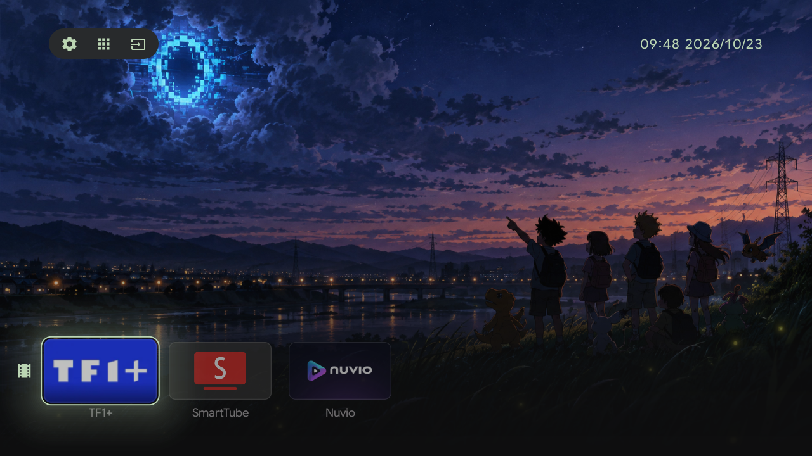

# Android TV — débloat, accueil et réseau

**Français** · [English](README.md)

Une méthode reproductible pour nettoyer **n'importe quelle Android TV / Google TV**, lui donner un
écran d'accueil minimal, et garder Chromecast qui fonctionne.

Pas de magie, pas d'APK miracle : des règles, des commandes `adb` vérifiables, et les pièges
rencontrés en vrai. Le dossier a été écrit sur une TCL C06 (Android 11) et tout ce qui dépend du
modèle est signalé comme tel.

## Ce qu'il y a ici

| Dossier | Contenu |
|---|---|
| [`docs/01-debloat.md`](docs/fr/01-debloat.md) | désactiver sans casser : catégories, `PERSISTENT`, listes de retour |
| [`docs/02-launcher.md`](docs/fr/02-launcher.md) | un accueil maison (source, build sans Gradle, installation) |
| [`docs/03-network.md`](docs/fr/03-network.md) | la TV injoignable, la passerelle au mauvais endroit, Chromecast |
| [`docs/04-unitedu.md`](docs/fr/04-unitedu.md) | prendre un launcher existant et le mettre en HOME |
| [`docs/fr/05-launchers.md`](docs/fr/05-launchers.md) | cinq accueils open source comparés (licence, minSdk, ABI) |
| [`docs/06-case-study.md`](docs/fr/06-case-study.md) | le dossier complet sur une TCL C06, chiffres à l'appui |
| [`apks/`](apks/) | les APK officiels des launchers comparés, avec SHA-256 |
| [`debloat/`](debloat/) | scripts d'export, de désactivation et de retour arrière |
| [`launcher/`](launcher/) | le launcher complet : Java, assets, build, installation |
| [`PROMPT.md`](PROMPT.fr.md) | le prompt à donner à un agent (OpenCode, Claude Code, Codex…) |

## Ça marche sur quoi

- **Android 9 (API 28) et plus** pour le rôle HOME moderne (`cmd role add-role-holder`) ;
  `pm disable-user` fonctionne depuis bien plus longtemps.
- **Google TV et Android TV** classiques. **Fire OS** est à part : les commandes `pm` passent,
  mais l'accueil n'est pas remplaçable sans root.
- Certaines ROM constructeur **refusent les launchers tiers** (TCL/FFALCON selon les modèles,
  Xiaomi récents, Skyworth) : la méthode de débloat s'applique quand même, pas le remplacement
  d'accueil.
- Vérifier avant d'installer un APK : `minSdkVersion` et ABI (`aapt2 dump badging`). Beaucoup de
  TV modestes sont **armeabi-v7a uniquement** — un APK arm64 ne s'installe pas.

## La méthode en quatre étapes

1. **Découvrir et sauver** : modèle, SDK, RAM, apps installées, accueil actuel, port Cast 8009,
   liste des paquets désactivés. Tout ce qui n'est pas noté ne pourra pas être annulé.
2. **Désactiver par petites vagues**, jamais désinstaller, jamais toucher aux `PERSISTENT`, et
   vérifier après chaque vague que Chromecast et l'accueil répondent encore.
3. **Choisir un accueil** : celui du dépôt, ou un open source du comparatif ; le poser via le
   rôle HOME et vérifier que la touche HOME y arrive vraiment.
4. **Diagnostiquer le réseau** si la TV « a une IP mais ne répond pas » : ARP, route par défaut,
   passerelle. Un affichage d'IP ne prouve rien.

## Le dossier complet sur une TCL C06

47 paquets désactivés, 2 `PERSISTENT` suspendus, un launcher maison puis UnitedU en accueil, et
deux pannes réseau élucidées — chiffres, commandes et captures dans
[`docs/06-case-study.md`](docs/fr/06-case-study.md).

## Les cinq accueils comparés

Quatre APK officiels prêts à installer et un projet qui refuse de s'installer sous Android 11,
avec captures, licences et empreintes SHA-256 : [`docs/fr/05-launchers.md`](docs/fr/05-launchers.md),
binaires dans [`apks/`](apks/).

| Launcher | Licence | minSdk | Android 11 |
|---|---|---|---|
| GlassOS | GPL-3.0 | 22 | ✅ |
| Couchy | GPL-3.0 | 21 | ✅ |
| tv-launcher (zhengnanli) | MIT | 31 | ❌ Android 12+ |
| LTvLauncher | GPL-3.0 | 21 | ✅ |
| UnitedU | Apache-2.0 | 28 | ✅ |

### Captures

<table>
<tr>
<td align="center"><br><sub><b>GlassOS</b> — verre dépoli, grille à la demande</sub></td>
<td align="center"><br><sub><b>Couchy</b> — dock flottant, trois dispositions</sub></td>
</tr>
<tr>
<td align="center"><br><sub><b>tv-launcher</b> — dock de quatre tuiles (Android 12+)</sub></td>
<td align="center"><br><sub><b>LTvLauncher</b> — catégories et widgets</sub></td>
</tr>
<tr>
<td align="center"><br><sub><b>UnitedU</b> — capture réelle sur la TV de test</sub></td>
<td align="center"><br><sub>GlassOS, centre de contrôle</sub></td>
</tr>
</table>

## Arborescence

```
apks/       les APK officiels des launchers comparés (non modifiés)
debloat/    export de la liste, désactivation et retour arrière
launcher/   source du launcher tvhome, ressources, build et scripts d'installation
docs/       ce qui a été fait, et pourquoi
```

## Démarrage rapide

```powershell
# 1. Sauver l'état actuel de la télé
powershell -ExecutionPolicy Bypass -File debloat\export.ps1 -Ip <IP_DE_LA_TV>

# 2. Construire le launcher (JDK 21 + build-tools 36.1 + android-34)
powershell -ExecutionPolicy Bypass -File launcher\build.ps1

# 3. L'installer et en faire l'accueil par défaut
powershell -ExecutionPolicy Bypass -File launcher\install-tvhome.ps1 -Ip <IP_DE_LA_TV>
```

Tous les scripts prennent `-Ip` ; aucune adresse d'un réseau réel n'est dans ce dépôt.

## Règles de sécurité appliquées

- **Désactiver, jamais désinstaller.** `pm disable-user` se défait avec `pm enable` ; une
  désinstallation d'app système ne se défait pas sans l'APK d'origine.
- **Jamais toucher aux paquets `PERSISTENT`** (ils se relancent au boot et une désactivation
  laisse la télé dans un état bizarre). Les deux concernés ont été *suspendus*, pas désactivés,
  et le flag ne survit pas à un redémarrage — c'est volontaire.
- **Garder une liste de retour** avant toute action, et la relire après un reboot.
- **Vérifier Chromecast après chaque vague** : port `8009` en écoute, `mediashell` et `gms` vivants.

## Refaites-le avec une IA

[`PROMPT.md`](PROMPT.fr.md) contient le prompt à coller dans OpenCode, Claude Code, Codex ou
n'importe quel agent avec accès au shell : découverte de la TV, liste de paquets proposée puis
validée, désactivation par lots avec vérification de Chromecast, installation de l'accueil, et
compte rendu avant/après. Rien n'est destructif sans accord, rien n'est affirmé sans commande.

## Crédits

- Launcher d'origine : [Ansub/tv-detox](https://github.com/Ansub/tv-detox), MIT.
  Notre fork avec l'APK : [Potowai/tv-detox](https://github.com/Potowai/tv-detox/releases/latest).
- UnitedU : [GordonWang1878/UnitedU-launcher](https://github.com/GordonWang1878/UnitedU-launcher), Apache-2.0.
- GlassOS, Couchy, LTvLauncher, tv-launcher : voir [`apks/README.md`](apks/README.md).
- Fond d'écran : « Nautical twilight sunset over Sandy Lake » par **Trougnouf**, CC BY 4.0,
  [Wikimedia Commons](https://commons.wikimedia.org/wiki/File:Nautical_twilight_sunset_over_Sandy_Lake_(DSCF3005).jpg).
