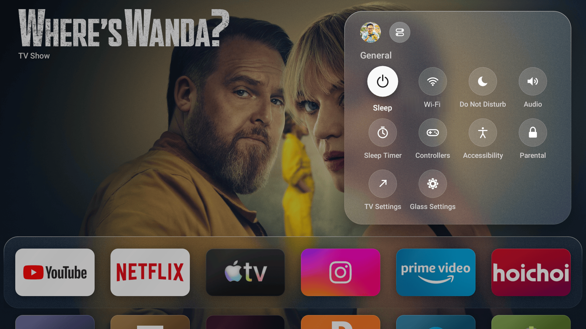
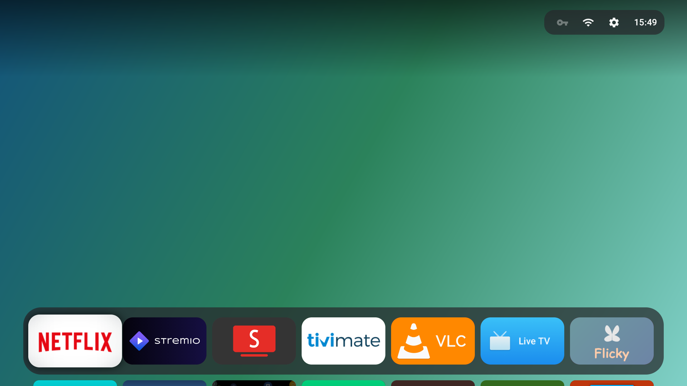
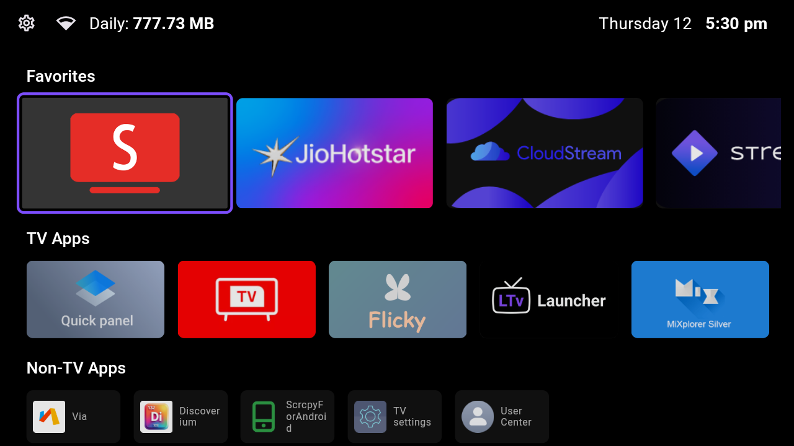
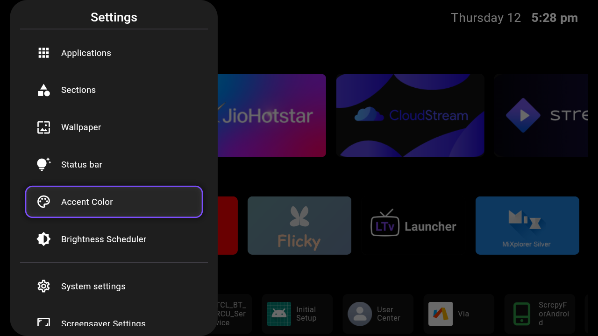
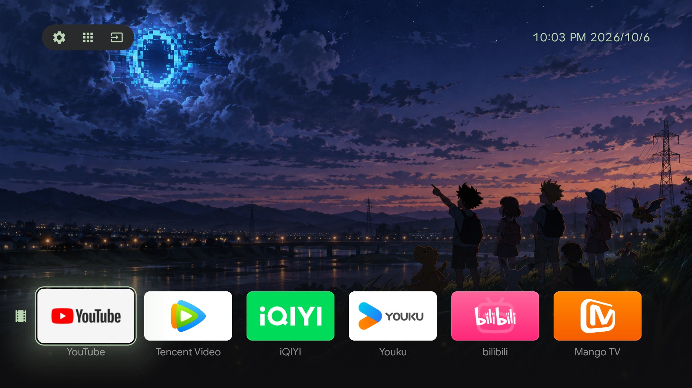

# 5. Les cinq écrans d'accueil comparés

Cinq launchers open source examinés pour la TCL C06 (Android 11 / API 30, 1280 × 720,
**armeabi-v7a uniquement**). Les APK officiels non modifiés sont dans [`apks/`](../apks/),
les captures viennent des dépôts d'origine.

| Launcher | Licence | minSdk | APK ici | Sur la C06 |
|---|---|---|---|---|
| [GlassOS](#glassos) | GPL-3.0 | 22 | `GlassOS-v1.0.2-beta.apk` (0,2 Mo) | ✅ |
| [Couchy](#couchy) | GPL-3.0 | 21 | `Couchy-Launcher-v1.0.6.apk` (2,2 Mo) | ✅ |
| [tv-launcher (zhengnanli)](#tv-launcher) | MIT | **31** | — (source seule) | ❌ Android 12+ |
| [LTvLauncher](#ltvlauncher) | GPL-3.0 | 21 | `LTvLauncher-armeabi-v7a-release.apk` (9,4 Mo) | ✅ |
| [UnitedU](#unitedu) | Apache-2.0 | 28 | `unitedu-1.2.0.apk` (13,1 Mo) | ✅ installé |

Vérification faite avec `aapt2 dump badging` sur chaque APK : c'est ce qui a éliminé le
`tv-launcher` de zhengnanli, déclaré `minSdkVersion 31` alors que la télé est en API 30.

```bash
adb install -r apks/Couchy-Launcher-v1.0.6.apk
adb shell cmd package set-home-activity --user 0 <paquet>/.<Activity>
```

## GlassOS




- **Dépôt** : [AbhishekKaisar/glassos-tv](https://github.com/AbhishekKaisar/glassos-tv) — GPL-3.0
- **Paquet** : `io.github.abhishekkaisar.glassos`
- **Idée** : une rangée de favoris en verre dépoli, une grille complète à la demande, un centre de
  contrôle, un « Top Shelf » de contenus mis en avant. Très proche de tvOS.
- **Pour la C06** : 200 Ko, s'installe et tourne (API 22 minimum, `targetSdk` 28). C'est en beta,
  et le `targetSdk` ancien peut gêner sur les futures versions d'Android.

## Couchy



- **Dépôt** : [conreo/couchy-launcher](https://github.com/conreo/couchy-launcher) — GPL-3.0
- **Paquet** : `com.conreo.couchytv`
- **Idée** : un seul écran, trois dispositions au choix (carrousel, grille, dock flottant en verre),
  fonds personnalisés, horloge, raccourcis réseau. 17 langues, aucun traqueur.
- **Pour la C06** : 2,2 Mo, `minSdk` 21, `targetSdk` 34 — le plus « fini » des quatre qui passent.

## tv-launcher


- **Dépôt** : [zhengnanli/tv-launcher](https://github.com/zhengnanli/tv-launcher) — MIT
- **Paquet** : `com.ambient.launcher`
- **Idée** : petit dock de quatre tuiles dans une bande arrondie, grille de quatre colonnes,
  sélection en verre, raccourcis HDMI / Wi-Fi / paramètres, pensé pour du matériel modeste.
- **Pour la C06** : **aucun APK fourni ici**, volontairement : le manifeste déclare
  `minSdkVersion 31`, donc Android 11 refuse l'installation (`INSTALL_FAILED_OLDER_SDK`). Le code
  se compile avec son `build.sh` (recyclerView + R8 depuis Maven) pour une télé Android 12+.

## LTvLauncher





- **Dépôt** : [leanbitlab-org/LtvLauncher](https://github.com/leanbitlab-org/LtvLauncher) — GPL-3.0
- **Paquet** : `com.leanbitlab.ltvL`
- **Idée** : catégories, widgets (dont la consommation Wi-Fi), lecteur IPTV intégré, indicateurs de
  sélection lumineux. Le plus fourni des cinq.
- **Pour la C06** : l'APK **armeabi-v7a** est celui qu'il faut ici (le dépôt publie aussi arm64 et
  universal). 9,4 Mo, `targetSdk` 35.

## UnitedU



- **Dépôt** : [GordonWang1878/UnitedU-launcher](https://github.com/GordonWang1878/UnitedU-launcher) — Apache-2.0
- **Paquet** : `com.uniteduone.launcher`
- **Idée** : uniquement les apps choisies, en rangées de cartes ; trois boutons en haut à gauche
  (Paramètres, Toutes les apps, Entrées), horloge en haut à droite ; cartes 5/6/8 par rangée.
- **Pour la C06** : c'est celui qui tourne aujourd'hui. 13,1 Mo, `minSdk` 28, PSS ≈ 112 Mo — le
  plus lourd des cinq sur une télé à 1 Go.

## Ce qu'on en retient

- **Vérifier `minSdkVersion` et l'ABI avant d'installer** : sur une télé de 2018 en 720p, deux
  lignes de `aapt2 dump badging` évitent d'installer un APK qui refuse de s'ouvrir.
- **`cmd package set-home-activity`** suffit à basculer d'un launcher à l'autre : aucun
  n'a besoin de désinstaller les autres, et le retour en arrière est immédiat.
- Le plus proche de la maquette « cartes compactes + barre du bas » reste **UnitedU** ; le plus
  léger et le plus proche de l'esprit « verre » est **GlassOS**.
